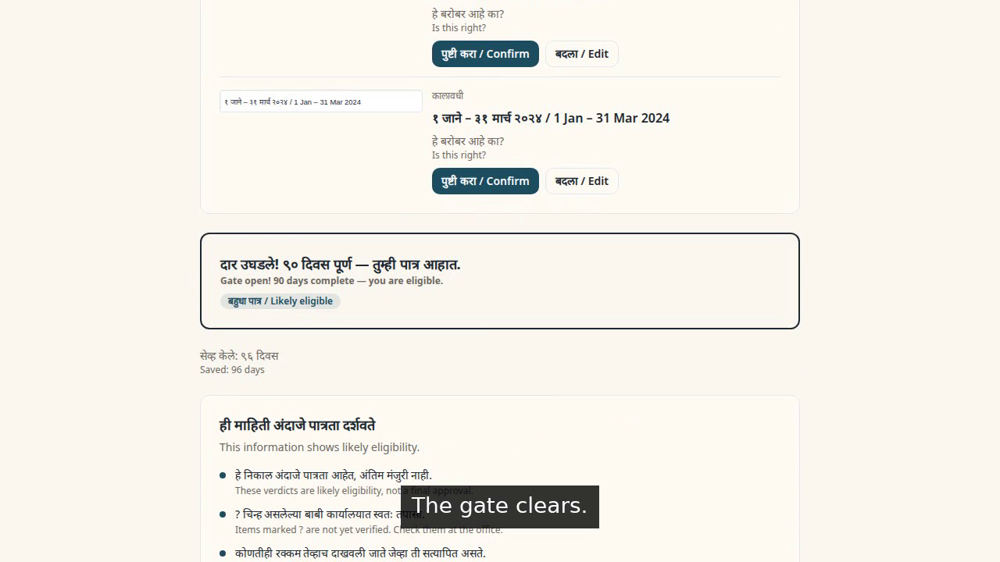
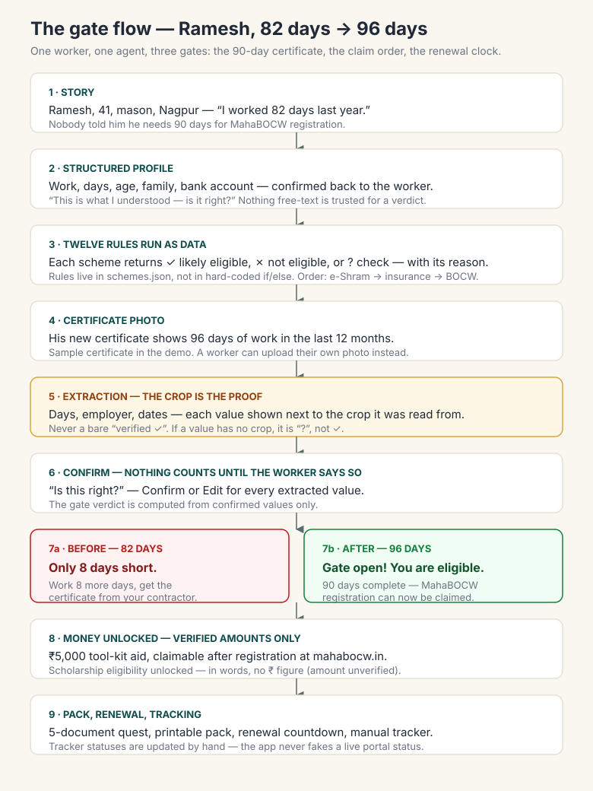
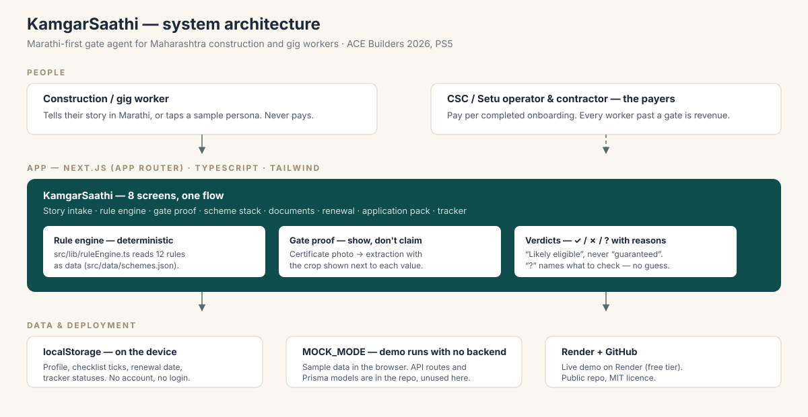
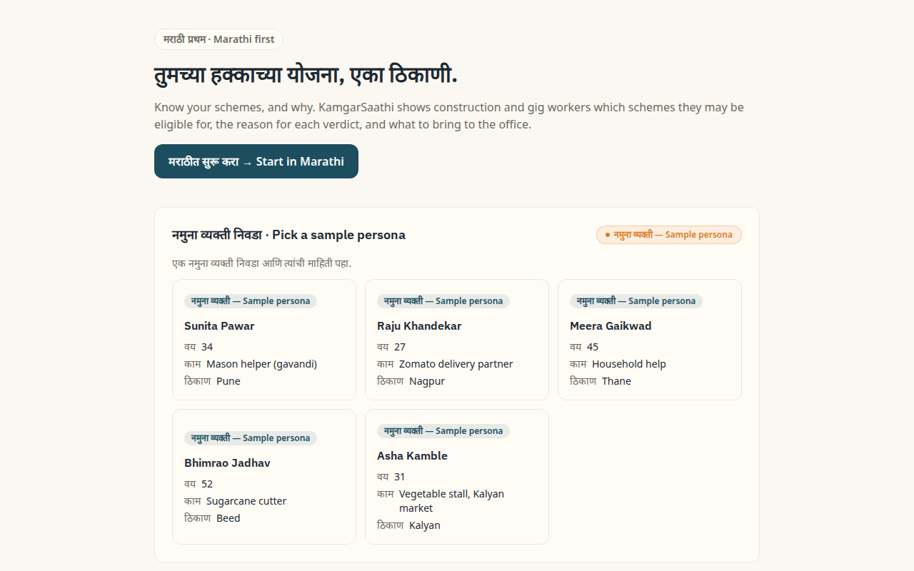
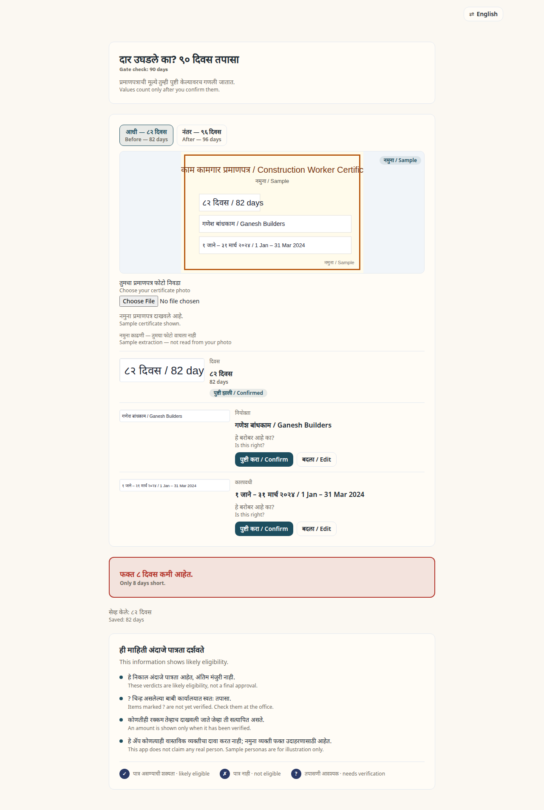
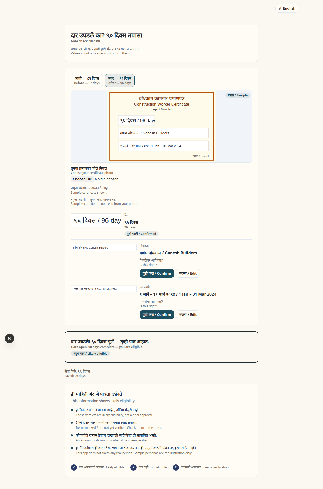
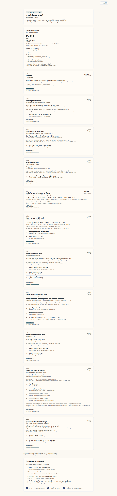
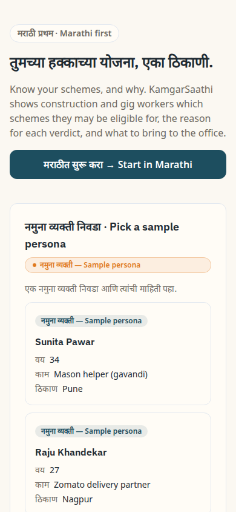
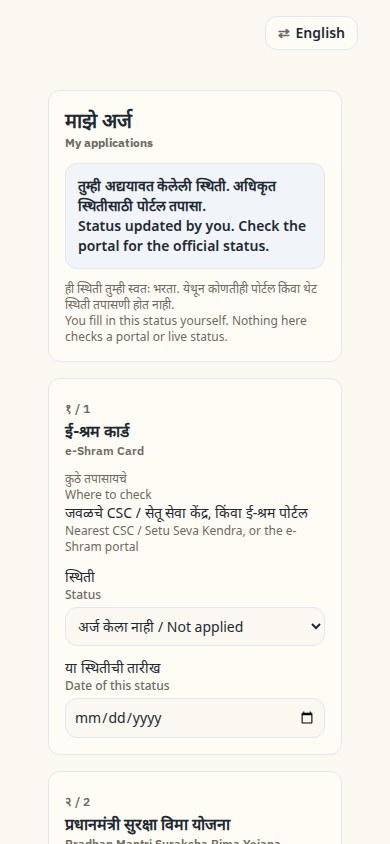
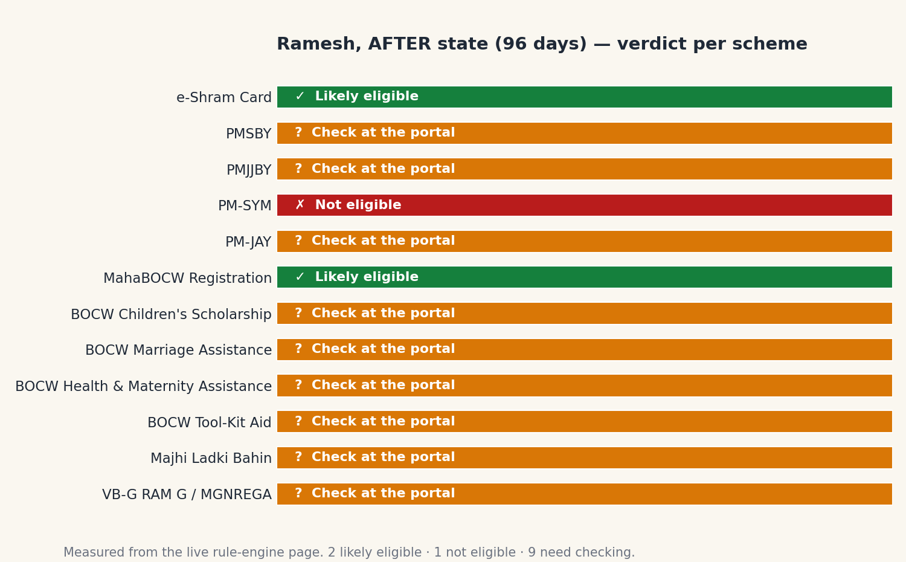

# KamgarSaathi

**A Marathi-first gate agent for Maharashtra's construction and gig workers — it tells a worker which government schemes they are likely eligible for, why, and what to bring to the office.**

🔗 **Live demo:** https://kamgarsaathi.onrender.com
🎬 **Demo video (56 seconds):** [docs/demo/kamgarsaathi-demo.mp4](docs/demo/kamgarsaathi-demo.mp4)

Built solo in the Codebenders IDE for **ACE Builders 2026, Problem Statement 5 — Citizens and Public Services ("Claim What's Yours")**.

---

## The problem

Maharashtra has about 17.5 lakh construction workers. The money exists — BOCW benefits, scholarships, tool-kit aid — but it does not reach them, because the path is blocked by gates nobody explains: a **90-day work certificate** for MahaBOCW registration, an **annual renewal that quietly lapses**, and a **claim order** nobody tells them. The official portal is a bare three-question check, so workers depend on middlemen who charge for help that should be free.

KamgarSaathi is not another scheme list. It is a **gate agent**: the worker tells their story in Marathi, the agent proves the 90-day gate from a certificate photo, runs 12 real schemes as editable rules with the reasoning shown for each, orders the claims, and guards the renewal with a countdown.

**The worker never pays.** The payers are CSC / Setu Seva Kendra operators and contractors doing bulk onboarding — every worker the agent gets past a gate is a completed onboarding they earn on.

---

## Watch it work — 56 seconds

[](docs/demo/kamgarsaathi-demo.mp4)

*Click the image to play the demo video (56 s, no audio). The video is a real recording of the live app: Ramesh's profile at 82 days, the certificate extraction at 96 days, the gate flipping green, the ₹5,000 tool-kit aid appearing, the document quest, and the renewal countdown.*

---

## How it works



1. **Story** — the worker tells their story in Marathi, or taps a sample persona.
2. **Structured profile** — work, days, age, family, bank account, confirmed back to the worker before anything is decided.
3. **Twelve rules run as data** — every scheme returns ✓ likely eligible, ✗ not eligible, or ? check, with its reason in Marathi and English.
4. **Certificate photo** — the agent extracts days, employer, and dates from the certificate.
5. **The crop is the proof** — each extracted value is shown next to the crop it was read from, and the worker confirms or edits it. Nothing counts until confirmed.
6. **Gate verdict** — 82 days: "Only 8 days short." 96 days: "Gate open! You are eligible."
7. **Money unlocked** — verified amounts only. The demo's moving number is the **₹5,000 tool-kit aid**.
8. **Pack, renewal, tracking** — a 5-document quest, a printable application pack, a renewal countdown, and a manual application tracker.



---

## Screenshots

### Home — Marathi first, sample personas



### The gate, before and after

Ramesh at 82 days — the gate is blocked, and the agent says exactly what to do next:



Ramesh at 96 days — the gate clears, with the crop shown next to every extracted value:



### Scheme stack — ₹5,000 unlocked, scholarship eligibility in words



### On a phone — the way most workers will see it

| Home | Application tracker |
|---|---|
|  |  |

---

## The 12 schemes — Ramesh, after state (96 days)

Verdicts measured from the live rule-engine page for the default profile (Ramesh, 41, mason, Nagpur, 96 days worked in the last 12 months). The engine is deliberately not a "everyone passes" toy: it fails PM-SYM honestly, because entry closes at 40.



| # | Scheme | Verdict | Why |
|---|---|---|---|
| 1 | e-Shram Card | ✓ Likely eligible | Gateway registration for unorganised workers |
| 2 | PMSBY | ? Check at the portal | Age window unverified; bank account confirmed |
| 3 | PMJJBY | ? Check at the portal | Age window unverified; bank account confirmed |
| 4 | PM-SYM | ✗ Not eligible | Entry age is 18–40; Ramesh is 41 — too late to join |
| 5 | PM-JAY | ? Check at the portal | Eligibility route (SECC list / 70+ cover) unverified |
| 6 | MahaBOCW Registration | ✓ Likely eligible | 96 days clears the 90-day gate; age 41 in range |
| 7 | BOCW Children's Scholarship | ? Check at the portal | Needs active MahaBOCW registration; amount unverified |
| 8 | BOCW Marriage Assistance | ? Check at the portal | Needs active MahaBOCW registration; amount unverified |
| 9 | BOCW Health & Maternity Assistance | ? Check at the portal | Needs active MahaBOCW registration; amount unverified |
| 10 | BOCW Tool-Kit Aid | ? Check at the portal | Needs active MahaBOCW registration — ₹5,000 once registered |
| 11 | Majhi Ladki Bahin | ? Check at the portal | For women 21–65; new-applications window unverified |
| 12 | VB-G RAM G / MGNREGA | ? Check at the portal | Rural-household check; wage and days unverified |

**Verified amounts shown in the app:** PM-SYM ₹3,000/month pension from age 60 · PM-JAY ₹5,00,000/family/year health cover · BOCW Tool-Kit Aid ₹5,000 one-time · Majhi Ladki Bahin ₹1,500/month. Amounts for the scholarship, marriage assistance, health assistance, and MGNREGA are **not shown anywhere in the app** — sources conflict, so the app shows eligibility in words only until they are re-checked at mahabocw.in. No total is ever added up across schemes; each amount stands on its own.

The claim order is part of the product: **e-Shram first** (gateway identity) → **PMSBY / PMJJBY / PM-SYM / PM-JAY** (age + bank + income only, no BOCW gate) → **MahaBOCW registration** (needs the 90-day gate) → **BOCW benefits** (need active registration) → **Majhi Ladki Bahin** in parallel for women → **MGNREGA** as the fallback when work dries up.

---

## Honesty principles

These are load-bearing, not copy:

- **Show the crop next to every extracted value — never a bare "verified ✓".** If a value has no crop, it is "?", not ✓.
- **"Likely eligible", never "guaranteed".** Every verdict is a reasoned likelihood, not a promise of approval.
- **"?" names what to check — never a guess.** An unverified fact stays unverified in the UI until it is checked at the official portal.
- **Only verified ₹ figures are shown.** The demo's moving number is the ₹5,000 tool-kit aid. Scholarship, marriage, and health amounts are shown as eligibility in words only.
- **Sample personas are labelled samples.** Ramesh, Arjun, and Sunita are fictional demo personas. The app never claims a real person was helped.
- **No Aadhaar number is ever typed or stored.** Aadhaar is show-only at the centre. The app records nothing about it.
- **The application tracker is manual.** Statuses are updated by the user, by hand. The app never checks a portal or fakes a live status — the tracker says so on screen.
- **No live government API is faked.** There is no public API for application status; the app does not pretend otherwise.

---

## Tech stack

- **Next.js 15** (App Router) · **React 18** · **TypeScript** · **Tailwind CSS**
- **Rule engine** (`src/lib/ruleEngine.ts`) — deterministic evaluation of the 12 scheme rules, stored as editable data in `src/data/schemes.json`
- **Certificate extraction** (`src/lib/certificateExtract.ts`) — sample extraction in the demo; the crop is shown next to each extracted value
- **localStorage** — profile, checklist ticks, renewal date, and tracker statuses live on the device; no account, no login
- **Prisma + API routes** are in the repo; the deployed demo runs in **MOCK_MODE** with sample data and needs no database
- **Deployed on Render** (free tier) · **Public repo, MIT licence**

### Project structure

```
src/app/            Next.js App Router pages (8 screens) + API routes
src/app/(app)/      story-intake · rule-engine-evaluation · gate-proof-moment
                    scheme-stack-unlocked · documents · renewal-countdown
                    pre-filled-application-pack · workers · my-applications
src/lib/            ruleEngine.ts · certificateExtract.ts · api.ts
src/data/           schemes.json — the 12 scheme rules as data
src/components/     shared UI
src/types/          profile · scheme · certificate · worker · document
prisma/             data models (present; the demo runs without a database)
docs/               screenshots · diagrams · demo video
PRD.md              product requirements
BUILD-PACKET.md     build spec — schemes, personas, copy, demo script
```

### Screens

| Route | Screen |
|---|---|
| `/` | Home + persona picker |
| `/story-intake` | Story intake (Marathi chips) |
| `/rule-engine-evaluation` | Rule engine — 12 schemes with per-rule reasons |
| `/gate-proof-moment` | Gate proof — certificate, crop, confirm, verdict |
| `/scheme-stack-unlocked` | Scheme stack in claim order + ₹ unlocked |
| `/documents` | Document quest — 5 items, where / cost / days |
| `/renewal-countdown` | Renewal countdown from the registration date |
| `/pre-filled-application-pack` | Printable application pack |
| `/workers` · `/workers/ramesh` | Sample personas — Ramesh (41, mason), Arjun (24, rider), Sunita (35, helper) |
| `/my-applications` | Manual application tracker |

### Run locally

```bash
npm install
npm run dev
```

Open http://localhost:3000. No sign-in needed — the demo runs in MOCK_MODE with sample data stored in localStorage. (Render free tier: the first load of the live demo can take up to a minute while the instance wakes.)

---

## What is not here yet

- **No named real-world user yet.** The proof point — a 10-minute call with a CSC / Setu operator or contractor confirming the gate problem — is still to be done. Until it happens, the pitch says so honestly instead of inventing a user.
- **Some scheme facts are still unverified** — PMSBY/PMJJBY age windows, the PM-JAY eligibility route, scholarship / marriage / health amounts, MGNREGA wage and days, and the Ladki Bahin new-applications window. The app shows "?" for all of them.
- **No live portal checks.** Application status is tracked by hand, by design.
- **Demo data only.** Personas and certificates in the demo are samples; the extraction shown is a sample extraction, not a read from the user's photo.

---

## Licence

MIT — see [LICENSE](LICENSE). Copyright (c) 2026 Ronit Shrimankar.
